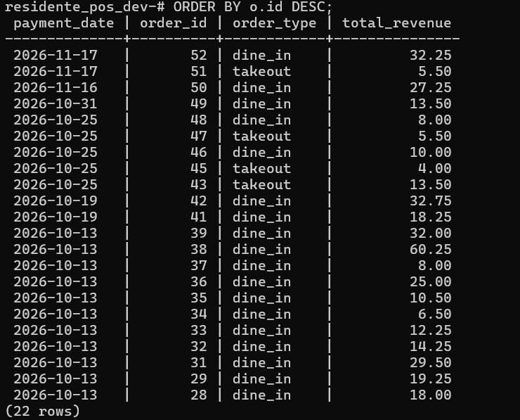
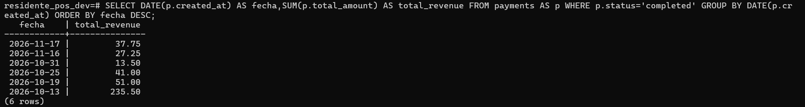
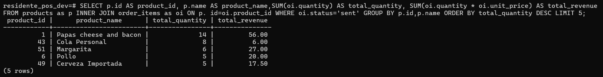
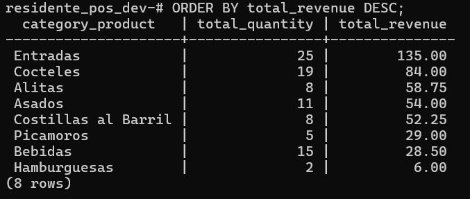

# RESIDENTE POS — SQL Data Analysis

This project demonstrates practical SQL skills using a PostgreSQL database developed for a restaurant Point of Sale (POS) system.

The exercises focus on extracting, joining, filtering, and analyzing transactional data to generate meaningful business insights.

---

## Exercise 01 — Closed Orders: Itemized Details and Subtotals

**Objective:** Retrieve detailed information about closed orders, including order types, guest numbers, purchased products, quantities, unit prices, and calculated line-item subtotals.

### SQL Concepts Applied

- Three INNER JOIN operations connecting four relational tables
- WHERE with multiple conditions
- Arithmetic calculations
- ORDER BY with multiple sorting criteria

### SQL Query

[View SQL Query](queries/01_closed_orders_details.sql)

### Query Results

### Key Takeaway

This exercise demonstrates how relational tables can be joined to retrieve detailed restaurant transactions and calculate product-level subtotals while excluding voided and pending items.
## Exercise 02 — Total Payment Revenue by Order and Date

**Objective:** Calculate total revenue from completed payments for each restaurant order, grouped by payment date, order ID, and order type.

### SQL Concepts Applied

- INNER JOIN connecting two relational tables (orders and payments)
- WHERE to filter completed payments
- SUM() to aggregate payment amounts
- DATE() to extract the payment date
- GROUP BY with multiple columns
- ORDER BY to sort orders by ID in descending order

### SQL Query

[View SQL Query](queries/02_total_revenue_byorder.sql)

### Query Results

### Key Takeaway

This exercise demonstrates how SQL aggregation functions can be used to calculate revenue from completed payments. By joining the orders and payments tables, the query summarizes payment amounts by date, order ID, and order type.

This analysis helps monitor restaurant revenue and provides useful information for financial reporting.
## Exercise 03 — Daily Revenue Ordering By Descending Date

**Objective:** Calculate the total daily revenue generated from successfully completed payments, displaying the results in descending order by payment date.

### SQL Concepts Applied

- WHERE to filter completed payments
- SUM() to aggregate payment amounts and calculate total daily revenue
- DATE() to extract the payment date
- GROUP BY to aggregate payments by date
- ORDER BY to sort orders by DATE in descending order

### SQL Query

[View SQL Query](queries/03_Daily_Revenue.sql)

### Query Results

### Key Takeaway

This analysis can help restaurant managers monitor daily sales trends, evaluate financial performance, and identify high-revenue and low-revenue business days.

## Exercise 04 — Top 5 Best-Selling Products by Quantity

**Objective:** Identify the five best-selling products based on total quantity sold and calculate the total revenue generated by each product.

### SQL Concepts Applied

- INNER JOIN to connect the products and order_items tables
- WHERE to filter sent items and exclude pending or voided items
- SUM() to calculate the total quantity sold per product
- Arithmetic calculations to determine total revenue
- GROUP BY to aggregate results by product ID and name
- ORDER BY to rank products by quantity sold in descending order
- LIMIT to retrieve only the top five products

### SQL Query

[View SQL Query](queries/04_Top_Selling_Products.sql)

### Query Results

### Key Takeaway

This exercise demonstrates how SQL aggregation functions can be used to identify the best-selling products in a restaurant.

By joining the products and order_items tables, the query calculates the total quantity sold and revenue generated by each product while excluding pending and voided items.

This analysis helps restaurant managers identify popular products, understand customer purchasing behavior, and make data-driven decisions regarding inventory management and sales performance.
## Exercise 05 — Revenue By Product Category

**Objective:** Calculate the total quantity sold and total revenue generated by each product category in the RESIDENTE POS database.

### SQL Concepts Applied

- INNER JOIN connecting three tables
- WHERE to filter items in the order items using conditional status='sent'
- SUM() aggregation
- GROUP BY with multiple columns
- ORDER BY DESC

### SQL Query

[View SQL Query](queries/05_Total_Revenue_By_ProductCategory.sql)

### Query Results

### Key Takeaway

This exercise demonstrates how to combine data from three related tables (order_items, products, and categories) to analyze sales performance by product category.

