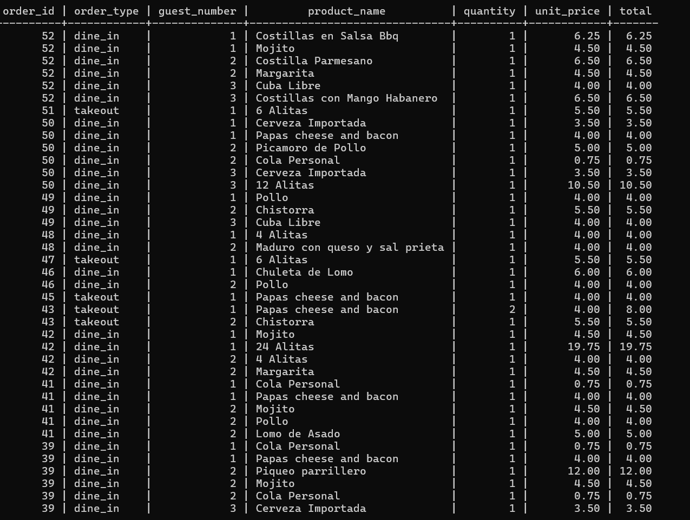

# RESIDENTE POS — SQL Data Analysis

This project demonstrates practical SQL skills using a PostgreSQL database developed for a restaurant Point of Sale (POS) system.

The exercises focus on extracting, joining, filtering, and analyzing transactional data to generate meaningful business insights.

---

## Exercise 01 — Closed Orders: Itemized Details and Subtotals

**Objective:** Retrieve detailed information about closed orders, including order types, guest numbers, purchased products, quantities, unit prices, and calculated line-item subtotals.

### SQL Concepts Applied

- Three INNER JOIN operations connecting four relational tables
- WHERE with multiple conditions
- Arithmetic calculations
- ORDER BY with multiple sorting criteria

### SQL Query

[View SQL Query](queries/01_closed_orders_details.sql)

### Query Results

### Key Takeaway

This exercise demonstrates how relational tables can be joined to retrieve detailed restaurant transactions and calculate product-level subtotals while excluding voided and pending items.
