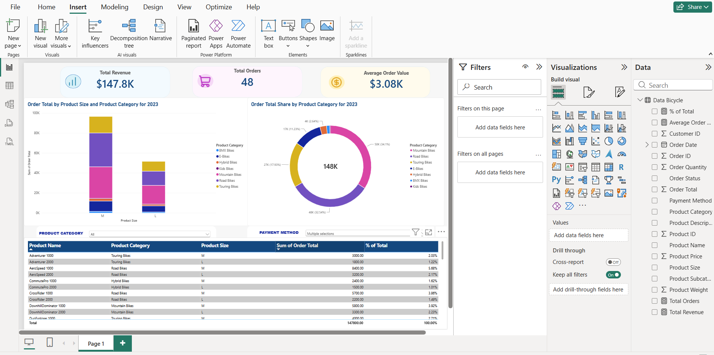

# Bicycle Sales Dashboard

## Project Overview
This project analyzes bicycle sales order data from 2023 using Microsoft Power BI.

The dashboard provides an interactive overview of order values, order volumes, product categories, and purchasing patterns.

## Tools and Technologies
- Microsoft Power BI
- DAX (Data Analysis Expressions)
- Microsoft Excel

## Key Performance Indicators
- Total Order Value(using SUM function)
- Total Orders
- Average Order Value (AOV)
- % of Total : Each product's contribution to the selected total, calculated using DIVIDE, CALCULATE, and ALLSELECTED.

## Dashboard Features
- Order value by product size and category
- Order value distribution by product category
- Interactive product category and payment method filters
- Product-level sales analysis
- Percentage contribution to total order value
## Dashboard Preview

